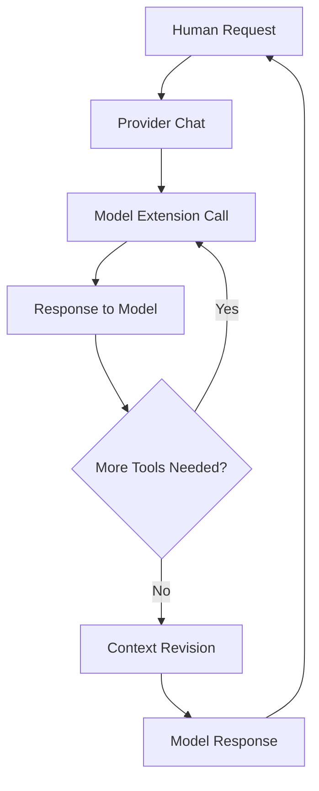

import { Metadata } from 'next';

export const metadata: Metadata = {
  title: 'Architecture Overview | Goose Documentation',
  description: 'Understanding Goose AI agent architecture - components, extensions, interactive loop, and error handling',
}

# Goose Architecture

Goose, an open source AI Agent, builds upon the basic interaction framework of Large Language Models (LLMs), which primarily functions as a text-based conversational interface. It processes text input and generates text output. This "text in, text out" approach is enhanced with tool integrations, which allows the AI agent to complete tasks, creating Goose.

## Goose Components

Goose operates using three main components: the **interface**, the **agent**, and the **connected extensions**.

### Interface

This is the desktop application or CLI that the user is using to run Goose. It collects input from the user and displays outputs to the user.

### Agent

The agent runs Goose's core logic, managing the interactive loop and coordinating between the interface and extensions.

### Extensions

Extensions are components that provide specific tools and capabilities for the agent to use. These tools enable Goose to perform actions such as running commands and managing files.

In a typical session, the interface spins up an instance of the agent, which then connects to one or more extensions simultaneously. The interface can also create multiple agents to handle different tasks concurrently.

## Interoperability with Extensions

[Model Context Protocol (MCP)](https://modelcontextprotocol.io/) is an open standard that allows for interoperability between data sources and AI agents. Goose utilizes MCP to connect to [MCP systems/servers](https://github.com/modelcontextprotocol/servers). In Goose, these systems/servers are referred to as extensions.

Extensions expose their functionality to Goose through **tools**. Tools are the functions that allow extensions to perform specific actions, such as running commands, or performing file operations. For example, the Google Drive extension includes a tool for searching documents. That tool is what gives Goose the ability to perform that action.

### Built-in Extensions

Goose comes with a set of built-in extensions, each designed to enhance your interaction:

- **Development tools** - File operations, code analysis, testing
- **Web scraping** - Data extraction from websites
- **Automation** - Task scheduling and workflow management
- **Memory** - Context persistence and knowledge storage
- **Integrations** - JetBrains IDE and Google Drive connectivity

### External Extensions

Goose also supports:

- [Connecting to external extensions](/ai/docs/mcp) as MCP servers
- [Creating custom extensions](/ai/docs/tutorials/advanced) tailored to your needs

## Interactive Loop

The core of Goose's functionality lies in its interactive loop:

Let's examine each step:

### 1. Human Request

The process begins and ends with you. Once you give Goose a request, question, command, or problem to solve, the flow begins.

### 2. Provider Chat

Goose sends your request along with a list of available tools to the LLM provider you've connected. The provider processes it, and if necessary, creates a tool call as part of its response.

### 3. Model Extension Call

The LLM is capable of creating a tool call request but not able to execute it - that's when Goose steps in. Goose takes the tool call (formatted in JSON), runs it, and gathers the results.

### 4. Response to Model

After executing the tool call, Goose sends the results back to the model. If more extensions are needed, those steps will repeat.

### 5. Context Revision

Goose will remove any old or irrelevant information, ensuring the LLM focuses solely on the information that matters the most. This helps with token management.

### 6. Model Response

Once all the tool calls are done, the LLM sends a final response back to you and restarts the loop once you respond.

## Error Handling

As opposed to allowing an error to break the flow, Goose captures and handles traditional errors along with execution errors. Errors such as:

- Invalid JSON responses
- Missing or unavailable tools
- Extension execution failures
- Network connectivity issues

These errors are sent back to the model as tool responses, giving the LLM the information it needs to resolve the error and continue.

### Error Recovery Strategies

1. **Automatic Retry** - For transient failures
2. **Fallback Tools** - Alternative approaches when primary tools fail
3. **User Notification** - Clear error messages for unrecoverable issues
4. **Context Preservation** - Maintaining conversation state during error recovery

For more details on error handling, see the [Error Handling Guide](/ai/docs/troubleshooting).

## Context Revision: Token Management

While Goose is free and open source, there is typically a cost associated with LLM token usage. Everything competes for token usage including messages, tool requests, resources, file content, instructions, etc.

Goose implements several strategies to optimize token usage:

### Cost Optimization Techniques

- **Summarization** - Uses faster and smaller LLMs for content summarization
- **Comprehensive Context** - Includes everything versus semantic search to avoid missing important information
- **Content Pruning** - Uses algorithms to delete old or irrelevant content
- **Efficient Operations** - Uses find-and-replace instead of rewriting large files
- **Smart Filtering** - Uses ripgrep to skip system files and summarizes verbose command outputs

### Token Management Best Practices

1. **Keep sessions focused** - Break large tasks into smaller, focused sessions
2. **Use appropriate models** - Choose the right LLM for the task complexity
3. **Regular cleanup** - Periodically start fresh sessions for long-running tasks
4. **Monitor usage** - Keep track of token consumption across providers

## Architecture Benefits

This architecture provides several key advantages:

- **Modularity** - Extensions can be developed and deployed independently
- **Extensibility** - Easy to add new capabilities through MCP servers
- **Reliability** - Robust error handling prevents session interruption
- **Efficiency** - Smart token management reduces operational costs
- **Interoperability** - Standard MCP protocol enables ecosystem growth

## Next Steps

- [Learn about Extensions Design](/ai/docs/architecture/toolkits)
- [Explore MCP Integration](/ai/docs/mcp)
- [Build Custom Extensions](/ai/docs/tutorials/advanced)
- [Configure Error Handling](/ai/docs/troubleshooting)

export default function ArchitecturePage() {
  return null

}
