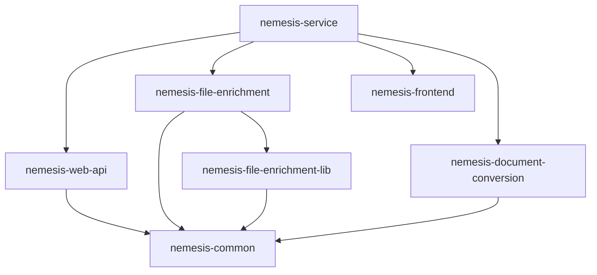

# Nemesis NX Best Practices Implementation

This document describes the reorganized Nemesis project structure following NX best practices.

## Overview

The Nemesis offensive file enrichment platform has been restructured as a proper NX monorepo with:

- **Individual NX Applications**: Each major service is now a separate NX project
- **Shared Libraries**: Common code moved to workspace-level libraries
- **Proper Dependencies**: Explicit dependency management between projects
- **Optimized Builds**: NX can build only affected projects
- **Better Testing**: Independent test suites with proper isolation

## New Project Structure

### Applications (`apps/`)

```
apps/
├── nemesis-service/                 # 🎯 Main orchestration project
│   ├── compose.yaml                # Docker Compose orchestration
│   ├── infra/                      # Infrastructure configurations
│   └── project.json               # NX orchestration config
├── nemesis-web-api/                # 🚀 FastAPI Web API
│   ├── web_api/                   # Python source code
│   └── project.json              # NX project config
├── nemesis-file-enrichment/        # 🔍 File Processing Service  
│   ├── file_enrichment/           # Python source code
│   └── project.json              # NX project config
├── nemesis-frontend/               # 🎨 React Frontend
│   ├── src/                       # React source code
│   └── project.json              # NX project config
└── nemesis-document-conversion/    # 📄 Document Processing
    ├── document_conversion/       # Python source code
    └── project.json              # NX project config
```

### Libraries (`libs/`)

```
libs/
├── nemesis-common/                 # 🔧 Shared utilities
│   ├── common/                    # Python package
│   └── project.json              # NX library config
└── nemesis-file-enrichment-lib/   # 📋 File analysis modules
    ├── file_enrichment_modules/   # Python package
    ├── yara_rules/               # YARA rule definitions
    └── project.json             # NX library config
```

## Key Improvements

### 1. **Proper Separation of Concerns**

Each service is now an independent NX project with:
- ✅ Individual build/test/lint targets
- ✅ Isolated dependencies
- ✅ Independent deployment capabilities
- ✅ Clear boundaries and interfaces

### 2. **Dependency Management**



### 3. **Optimized Build Process**

- **Affected Builds**: `nx affected:build` only builds changed projects
- **Parallel Execution**: Services can be built simultaneously
- **Caching**: NX caches successful builds across projects
- **Dependencies**: Proper build order via `dependsOn`

### 4. **Enhanced Development Workflow**

```bash
# Build all Nemesis projects
npx nx run-many --target=build --projects=nemesis-*

# Test all Nemesis projects
npx nx run-many --target=test --projects=nemesis-*

# Build only affected projects
npx nx affected:build

# Serve individual services
npx nx serve nemesis-web-api        # Port 8000
npx nx serve nemesis-file-enrichment # Port 8001
npx nx serve nemesis-frontend       # Port 3000
```

## Project-Specific Commands

### Main Orchestration (`nemesis-service`)

```bash
# Full platform orchestration
npx nx serve nemesis-service           # Start all services via Docker
npx nx build nemesis-service           # Build platform (depends on all services)
npx nx test nemesis-service            # Run all tests via dependencies
npx nx test:integration nemesis-service # Integration tests

# Docker operations
npx nx docker:up nemesis-service       # Start platform
npx nx docker:down nemesis-service     # Stop platform
npx nx status nemesis-service          # Check service status
```

### Web API Service (`nemesis-web-api`)

```bash
# Development
npx nx serve nemesis-web-api           # Start FastAPI dev server
npx nx test nemesis-web-api            # Run API tests
npx nx lint nemesis-web-api            # Lint Python code

# Production
npx nx build nemesis-web-api           # Build Python package
npx nx serve:prod nemesis-web-api      # Production server
npx nx docker:build nemesis-web-api    # Build container
```

### File Enrichment Service (`nemesis-file-enrichment`)

```bash
# Development  
npx nx serve nemesis-file-enrichment   # Start enrichment service
npx nx test nemesis-file-enrichment    # Run enrichment tests
npx nx type-check nemesis-file-enrichment # Type checking

# Production
npx nx build nemesis-file-enrichment   # Build service
npx nx docker:build nemesis-file-enrichment # Build container
```

### Frontend Application (`nemesis-frontend`)

```bash
# Development
npx nx serve nemesis-frontend          # Start React dev server  
npx nx test nemesis-frontend           # Run frontend tests
npx nx lint nemesis-frontend           # Lint TypeScript/React

# Production
npx nx build nemesis-frontend          # Build production bundle
npx nx serve:prod nemesis-frontend     # Preview production build
```

### Shared Libraries

```bash
# Common utilities library
npx nx build nemesis-common            # Build shared library
npx nx test nemesis-common             # Test utilities
npx nx lint nemesis-common             # Lint shared code

# File enrichment modules
npx nx build nemesis-file-enrichment-lib # Build analysis modules
npx nx yara:compile nemesis-file-enrichment-lib # Compile YARA rules
npx nx yara:validate nemesis-file-enrichment-lib # Validate rules
```

## VS Code Integration

New VS Code tasks available via Command Palette (`Ctrl+Shift+P`):

### Individual Services
- **Serve Nemesis Web API**: Start FastAPI service (port 8000)
- **Serve Nemesis File Enrichment**: Start enrichment service (port 8001)  
- **Serve Nemesis Frontend**: Start React dev server (port 3000)

### Bulk Operations
- **Test All Nemesis Services**: Run tests for all Nemesis projects
- **Build All Nemesis Services**: Build all Nemesis projects
- **Lint All Nemesis Services**: Lint all Nemesis projects

### Platform Operations
- **Serve Nemesis Service**: Full Docker Compose orchestration
- **Nemesis: Docker Up/Down**: Container lifecycle management

## Benefits of NX Best Practices

### 🚀 **Performance**
- **Incremental Builds**: Only rebuild changed projects
- **Parallel Execution**: Build services simultaneously  
- **Smart Caching**: Reuse previous build results
- **Affected Analysis**: Test only impacted code

### 🔧 **Developer Experience**
- **Clear Project Boundaries**: Each service is self-contained
- **Independent Development**: Work on services in isolation
- **Consistent Tooling**: Same commands across all projects
- **IDE Integration**: Better IntelliSense and navigation

### 🏗️ **Architecture**
- **Explicit Dependencies**: Clear service relationships
- **Shared Code Reuse**: Libraries prevent duplication
- **Deployment Flexibility**: Deploy services independently
- **Testing Isolation**: Focused, fast test suites

### 📦 **Packaging & Deployment**
- **Container Optimization**: Each service builds its own image
- **Dependency Tracking**: Only redeploy affected services
- **Environment Consistency**: Same build process everywhere
- **Service Discovery**: Clear API boundaries

## Migration Benefits

| Aspect | Before | After |
|--------|--------|-------|
| **Build Time** | Build entire monolith | Build only affected services |
| **Test Speed** | Run all tests always | Run tests for changed code |
| **Development** | Start all services | Start individual services |
| **Deployment** | Deploy everything | Deploy affected services |
| **Code Reuse** | Copy-paste between services | Shared libraries |
| **Dependencies** | Implicit, unclear | Explicit NX graph |

## Next Steps

1. **Update Import Paths**: Update Python imports to reference new library locations
2. **Configure CI/CD**: Set up NX-aware build pipeline with affected detection
3. **Add Integration Tests**: Create cross-service integration test suite
4. **Performance Monitoring**: Add per-service monitoring and metrics
5. **Documentation**: Generate NX dependency graphs and service documentation

## Troubleshooting

### Common Issues

```bash
# If builds fail due to missing dependencies
npx nx reset                           # Reset NX cache
npx nx run-many --target=install --projects=nemesis-*

# Check project dependencies
npx nx show project nemesis-web-api --with-deps

# Validate project graph
npx nx graph --focus=nemesis-service

# Debug affected projects
npx nx affected:apps
npx nx affected:libs
```

### Development Workflow

1. **Start Individual Service Development**:
   ```bash
   npx nx serve nemesis-web-api         # API on :8000
   npx nx serve nemesis-frontend        # UI on :3000
   ```

2. **Full Platform Testing**:
   ```bash
   npx nx serve nemesis-service         # Full Docker stack
   ```

3. **Incremental Development**:
   ```bash
   npx nx affected:build               # Build changed projects
   npx nx affected:test                # Test changed projects
   ```

This NX best practices implementation provides a solid foundation for scalable Nemesis development with clear boundaries, optimized builds, and excellent developer experience.

---

**Implementation Date**: November 12, 2024  
**NX Version**: Latest  
**Migration Status**: ✅ Complete