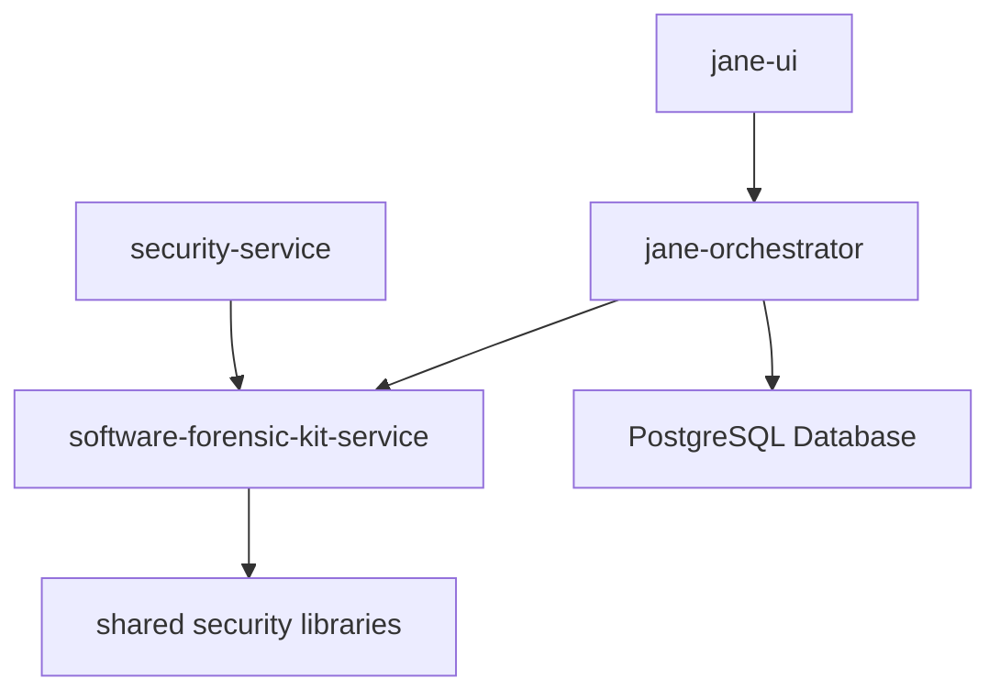

# Software Forensic Kit Integration Guide

## Overview

The Software Forensic Kit has been integrated as an NX project within the modular monolith architecture, providing binary analysis capabilities for Java applications as part of the security domain.

## Project Structure

```
apps/software-forensic-kit-service/
├── src/main/java/com/omnissa/software_forensic_kit/
│   ├── Java_Gadget_Kit.java              # Main CLI entry point
│   └── java_gadget/
│       ├── CallGraphAnalysis.java        # Core analysis engine
│       ├── CallGraphNode.java            # Call graph data structure
│       ├── agent/                        # Java agent for runtime instrumentation
│       │   └── Java_Gadget_Agent.java
│       ├── local/                        # Local JAR analysis
│       │   └── LocalCalls.java
│       └── remote/                       # Remote SSH analysis
│           └── RemoteCalls.java
├── src/test/java/                        # Unit tests (JUnit 5)
├── pom.xml                              # Maven build configuration
├── project.json                         # NX project configuration
├── Dockerfile                           # Container image definition
└── README.md                           # Comprehensive documentation
```

## Integration Points

### 1. Jane Orchestrator Integration

The Software Forensic Kit integrates with the Jane Orchestrator through:

#### Security Service API Endpoints
```python
# apps/jane-orchestrator/src/api/security_api.py

@router.post("/forensics/analyze-jar")
async def analyze_jar_file(request: JarAnalysisRequest):
    """
    Analyze JAR file for call graph relationships and security vulnerabilities.
    """
    # Execute forensic kit via subprocess or service call
    result = await run_forensic_analysis(
        jar_path=request.jar_path,
        search_pattern=request.search_pattern,
        analysis_options=request.options
    )
    return ForensicAnalysisResponse(**result)

@router.post("/forensics/search-functions")
async def search_functions(request: FunctionSearchRequest):
    """
    Search for specific function patterns across JAR files.
    """
    # Use forensic kit pattern matching capabilities
    pass
```

#### Database Integration
```python
# apps/jane-orchestrator/src/data/models/forensic_models.py

class ForensicAnalysisResult(Base):
    __tablename__ = "forensic_analysis_results"
    
    id: Mapped[int] = mapped_column(primary_key=True)
    jar_file_path: Mapped[str] = mapped_column(String(500))
    search_pattern: Mapped[str] = mapped_column(String(200))
    discovered_functions: Mapped[List[str]] = mapped_column(JSON)
    call_graph_data: Mapped[dict] = mapped_column(JSON)
    analysis_timestamp: Mapped[datetime] = mapped_column(DateTime, default=datetime.utcnow)
    analysis_duration: Mapped[float] = mapped_column(Float)  # seconds
    
class CallGraphRelationship(Base):
    __tablename__ = "call_graph_relationships"
    
    id: Mapped[int] = mapped_column(primary_key=True)
    analysis_id: Mapped[int] = mapped_column(ForeignKey("forensic_analysis_results.id"))
    caller_method: Mapped[str] = mapped_column(String(500))
    callee_method: Mapped[str] = mapped_column(String(500))
    call_depth: Mapped[int] = mapped_column(Integer)
```

### 2. NX Workspace Integration

#### Build Targets
```bash
# Build the Java application
npx nx build software-forensic-kit-service

# Run tests
npx nx test software-forensic-kit-service

# Code quality checks
npx nx lint software-forensic-kit-service

# Docker operations
npx nx docker:build software-forensic-kit-service
npx nx docker:run software-forensic-kit-service

# Analysis operations
npx nx analyze:help software-forensic-kit-service
npx nx analyze:local software-forensic-kit-service
```

#### Dependencies in NX Graph


### 3. Security Domain Integration

#### Service Layer Integration
```python
# apps/jane-orchestrator/src/services/security_service.py

class SecurityAnalysisService:
    def __init__(self):
        self.forensic_kit = ForensicKitService()
    
    async def analyze_application_security(self, app_path: str) -> SecurityReport:
        """
        Comprehensive security analysis including static code analysis.
        """
        # Discover JAR files
        jar_files = await self.discover_jar_files(app_path)
        
        # Run forensic analysis on each JAR
        forensic_results = []
        for jar_file in jar_files:
            result = await self.forensic_kit.analyze_jar(
                jar_path=jar_file,
                search_patterns=VULNERABILITY_PATTERNS
            )
            forensic_results.append(result)
        
        # Aggregate results into security report
        return self.generate_security_report(forensic_results)
    
    async def check_vulnerable_dependencies(self, jar_path: str) -> List[Vulnerability]:
        """
        Check for known vulnerable functions in dependencies.
        """
        return await self.forensic_kit.search_functions(
            jar_path=jar_path,
            patterns=KNOWN_VULNERABILITY_PATTERNS
        )
```

#### AI Integration (Security LLM Server)
```python
# apps/cyber-llm-server/src/forensic_analysis.py

class ForensicAnalysisAI:
    """
    AI-enhanced analysis of forensic kit results.
    """
    
    async def analyze_call_graph_risks(self, call_graph: dict) -> RiskAssessment:
        """
        Use AI to identify potential security risks in call graphs.
        """
        prompt = f"""
        Analyze this Java application call graph for security risks:
        
        Call Graph Data: {call_graph}
        
        Identify:
        1. Potential attack paths to sensitive functions
        2. Excessive privilege escalation patterns
        3. Vulnerable dependency usage
        4. Code reachability concerns
        """
        
        response = await self.llm.analyze(prompt)
        return RiskAssessment.from_ai_response(response)
```

## Configuration

### Environment Variables
```bash
# Jane Orchestrator environment
FORENSIC_KIT_PATH=/app/software-forensic-kit.jar
FORENSIC_KIT_JAVA_OPTS=-Xmx4g
FORENSIC_KIT_TEMP_DIR=/tmp/forensic-analysis
FORENSIC_KIT_SSH_TIMEOUT=30

# Docker Compose integration
FORENSIC_KIT_IMAGE=software-forensic-kit-service:latest
FORENSIC_KIT_MEMORY_LIMIT=4g
```

### Jane Orchestrator Configuration
```python
# apps/jane-orchestrator/src/config.py

class ForensicKitSettings(BaseSettings):
    jar_path: str = "/app/software-forensic-kit.jar"
    java_opts: str = "-Xmx4g -XX:+UseG1GC"
    temp_directory: str = "/tmp/forensic-analysis"
    max_analysis_time: int = 1800  # 30 minutes
    ssh_timeout: int = 30
    max_concurrent_analyses: int = 3
    
    class Config:
        env_prefix = "FORENSIC_KIT_"
```

## API Integration Examples

### REST API Endpoints

#### 1. JAR Analysis Endpoint
```http
POST /api/v1/security/forensics/analyze
Content-Type: application/json

{
    "jar_path": "/path/to/application.jar",
    "search_pattern": "com.vulnerable.*:process*",
    "options": {
        "max_depth": 10,
        "output_format": "json",
        "remove_duplicates": true
    }
}

Response:
{
    "analysis_id": "uuid",
    "status": "completed",
    "discovered_functions": [
        "com.vulnerable.Service:processData()",
        "com.vulnerable.Util:processRequest()"
    ],
    "call_graph": {
        "nodes": [...],
        "edges": [...]
    },
    "statistics": {
        "total_methods": 1250,
        "analyzed_methods": 856,
        "max_depth_reached": 8,
        "analysis_duration": 42.5
    }
}
```

#### 2. Batch Analysis Endpoint
```http
POST /api/v1/security/forensics/batch-analyze
Content-Type: application/json

{
    "jar_directory": "/opt/application/lib",
    "search_patterns": [
        "*vulnerable*",
        "*:execute*",
        "*Security*:*"
    ],
    "analysis_options": {
        "parallel": true,
        "max_concurrent": 3
    }
}
```

### WebSocket Integration for Real-time Progress

```javascript
// Jane UI real-time analysis monitoring
const ws = new WebSocket('ws://localhost:8000/api/v1/security/forensics/ws');

ws.onmessage = (event) => {
    const update = JSON.parse(event.data);
    
    switch (update.type) {
        case 'analysis_started':
            updateProgressBar(0, `Starting analysis of ${update.jar_file}`);
            break;
            
        case 'analysis_progress':
            updateProgressBar(update.progress, update.message);
            break;
            
        case 'analysis_completed':
            displayResults(update.results);
            break;
            
        case 'analysis_error':
            displayError(update.error_message);
            break;
    }
};
```

## Performance Integration

### Caching Strategy
```python
# apps/jane-orchestrator/src/services/forensic_cache.py

class ForensicAnalysisCache:
    """
    Cache forensic analysis results to avoid re-analyzing unchanged JARs.
    """
    
    async def get_cached_analysis(self, jar_path: str, jar_hash: str) -> Optional[AnalysisResult]:
        """
        Retrieve cached analysis result based on JAR file hash.
        """
        cache_key = f"forensic:{jar_hash}"
        return await self.redis.get(cache_key)
    
    async def cache_analysis_result(self, jar_hash: str, result: AnalysisResult):
        """
        Cache analysis result with TTL.
        """
        cache_key = f"forensic:{jar_hash}"
        await self.redis.setex(cache_key, 86400, result.json())  # 24 hour TTL
```

### Background Job Processing
```python
# apps/jane-orchestrator/src/tasks/forensic_tasks.py

@celery_app.task(bind=True)
def analyze_jar_async(self, jar_path: str, analysis_options: dict):
    """
    Asynchronous JAR analysis task.
    """
    try:
        # Update task progress
        self.update_state(state='PROGRESS', meta={'progress': 0, 'message': 'Starting analysis'})
        
        # Run forensic analysis
        result = run_forensic_kit_analysis(jar_path, analysis_options)
        
        # Store results in database
        save_analysis_results(result)
        
        # Update progress to completed
        self.update_state(state='SUCCESS', meta={'result': result})
        
        return result
        
    except Exception as e:
        self.update_state(state='FAILURE', meta={'error': str(e)})
        raise
```

## Testing Integration

### Unit Tests
```python
# tests/services/test_forensic_service.py

class TestForensicService:
    
    @pytest.mark.asyncio
    async def test_jar_analysis(self):
        service = ForensicKitService()
        
        # Mock forensic kit execution
        with patch('subprocess.run') as mock_run:
            mock_run.return_value = MagicMock(
                returncode=0,
                stdout='{"discovered_functions": ["test.method()"]}'
            )
            
            result = await service.analyze_jar("/test/sample.jar", "test.*")
            
            assert result.discovered_functions == ["test.method()"]
            mock_run.assert_called_once()
```

### Integration Tests
```python
# tests/integration/test_forensic_integration.py

class TestForensicIntegration:
    
    @pytest.mark.integration
    async def test_end_to_end_analysis(self):
        """
        Test complete forensic analysis workflow.
        """
        # Create test JAR file
        test_jar = create_test_jar_with_known_structure()
        
        # Submit analysis request
        response = await client.post('/api/v1/security/forensics/analyze', json={
            'jar_path': test_jar,
            'search_pattern': 'test.*'
        })
        
        assert response.status_code == 200
        result = response.json()
        
        # Verify analysis results
        assert 'analysis_id' in result
        assert len(result['discovered_functions']) > 0
        
        # Verify database storage
        stored_result = await get_analysis_from_db(result['analysis_id'])
        assert stored_result is not None
```

## Monitoring and Observability

### Metrics Collection
```python
# apps/jane-orchestrator/src/monitoring/forensic_metrics.py

from prometheus_client import Counter, Histogram, Gauge

# Metrics for forensic analysis
forensic_analyses_total = Counter('forensic_analyses_total', 'Total forensic analyses performed')
forensic_analysis_duration = Histogram('forensic_analysis_duration_seconds', 'Analysis duration in seconds')
forensic_analysis_errors = Counter('forensic_analysis_errors_total', 'Total forensic analysis errors')
active_analyses = Gauge('forensic_active_analyses', 'Number of currently running analyses')
```

### Health Checks
```python
# apps/jane-orchestrator/src/health/forensic_health.py

async def check_forensic_kit_health() -> HealthStatus:
    """
    Check if forensic kit is available and functional.
    """
    try:
        # Test forensic kit version command
        result = subprocess.run([
            'java', '-jar', FORENSIC_KIT_PATH, '--version'
        ], capture_output=True, timeout=10)
        
        if result.returncode == 0:
            return HealthStatus.HEALTHY
        else:
            return HealthStatus.UNHEALTHY
            
    except subprocess.TimeoutExpired:
        return HealthStatus.UNHEALTHY
    except Exception:
        return HealthStatus.UNHEALTHY
```

## Deployment Configuration

### Docker Compose Integration
```yaml
# infrastructure/docker/docker-compose.yml

services:
  forensic-kit:
    build:
      context: .
      dockerfile: apps/software-forensic-kit-service/Dockerfile
    image: software-forensic-kit-service:latest
    container_name: forensic-kit
    networks:
      - jane-network
    volumes:
      - forensic-temp:/tmp/forensic-analysis
      - jar-analysis:/data/jars
    environment:
      - JAVA_OPTS=-Xmx4g -XX:+UseG1GC
    restart: unless-stopped
    
  jane-orchestrator:
    depends_on:
      - forensic-kit
    environment:
      - FORENSIC_KIT_SERVICE_URL=http://forensic-kit:8080
```

### Kubernetes Deployment
```yaml
# infrastructure/k8s/forensic-kit-deployment.yml

apiVersion: apps/v1
kind: Deployment
metadata:
  name: forensic-kit-service
spec:
  replicas: 2
  selector:
    matchLabels:
      app: forensic-kit
  template:
    metadata:
      labels:
        app: forensic-kit
    spec:
      containers:
      - name: forensic-kit
        image: software-forensic-kit-service:latest
        resources:
          requests:
            memory: "2Gi"
            cpu: "500m"
          limits:
            memory: "4Gi"
            cpu: "2"
        volumeMounts:
        - name: temp-storage
          mountPath: /tmp/forensic-analysis
      volumes:
      - name: temp-storage
        emptyDir:
          sizeLimit: "10Gi"
```

This integration guide provides comprehensive documentation for how the Software Forensic Kit fits into the broader Jane Orchestrator ecosystem, enabling security analysis capabilities within the modular monolith architecture.