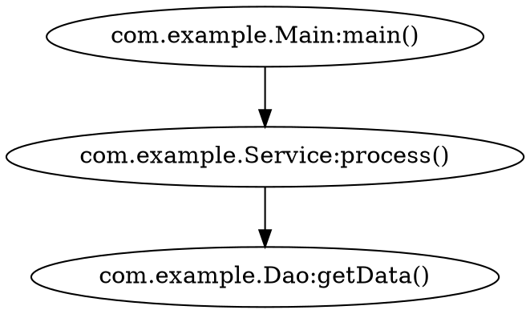

# Software Forensic Kit Service

A binary analysis toolkit for identifying code reachability and function usage in Java applications through callgraph analysis and dynamic injection.

## Overview

The Software Forensic Kit is a security analysis tool that helps identify:

- **Code Reachability**: Which functions in libraries are actually used by applications
- **Call Graph Relationships**: How methods call each other through bytecode analysis
- **Attack Paths**: Potential execution paths through vulnerable functions
- **Runtime Behavior**: Dynamic method interception via Java agent

## Features

### Core Analysis Capabilities
- **JAR File Analysis**: Parse Java bytecode to extract method call relationships
- **Pattern Matching**: Search for functions using wildcard patterns
- **Call Graph Construction**: Build hierarchical call graphs showing execution paths
- **Multiple Output Formats**: Text, HTML (vis.js), and GraphViz output

### Analysis Modes
- **Local Analysis**: Analyze JAR files on local filesystem
- **Remote Analysis**: Connect via SSH to analyze JAR files on remote servers
- **Java Agent Mode**: Runtime method interception in running applications

### Visualization Options
- **Console Output**: Human-readable text format with indented call paths
- **HTML Visualization**: Interactive web-based graphs using vis.js
- **GraphViz Output**: Professional graph rendering for reports

## Installation

### Prerequisites
- Java 8 or higher (JRE for execution, JDK for building)
- Maven 3.x+ (for building from source)
- SSH access (for remote analysis mode)

### Building from Source

```bash
# Build the project
npx nx build software-forensic-kit-service

# Or using Maven directly
mvn clean package -f apps/software-forensic-kit-service/pom.xml
```

### Docker Installation

```bash
# Build Docker image
npx nx docker:build software-forensic-kit-service

# Run with Docker
docker run --rm -v $(pwd)/data:/data software-forensic-kit-service [options]
```

## Usage

### Basic Local Analysis

```bash
# Analyze JAR files in a directory
java -jar software-forensic-kit.jar \\
  -s "ExampleClass:functionA" \\
  -f "/path/to/jars" \\
  -pp

# Search with wildcards
java -jar software-forensic-kit.jar \\
  -s "com.example.*:process*" \\
  -f "/app/lib/*.jar" \\
  -pp -cd 10
```

### Remote Analysis via SSH

```bash
# Analyze JARs on remote server
java -jar software-forensic-kit.jar \\
  -u username \\
  -p password \\
  -d 192.168.1.100 \\
  -s "VulnerableClass:*" \\
  -f "/opt/application/lib" \\
  -hi -o /tmp/results
```

### Java Agent Mode

```bash
# Monitor method calls in running application
java -javaagent:software-forensic-kit.jar="com.example.Service;processData" \\
     -jar target-application.jar

# Monitor multiple methods
java -javaagent:software-forensic-kit.jar="Class1;method1~Class2;method2" \\
     -jar target-application.jar
```

### NX Workspace Integration

This project follows NX best practices for optimal developer experience and performance.

```bash
# Development workflow
npx nx build software-forensic-kit-service:development
npx nx test software-forensic-kit-service
npx nx serve software-forensic-kit-service:development

# Code quality checks
npx nx lint software-forensic-kit-service
npx nx format software-forensic-kit-service
npx nx format:check software-forensic-kit-service

# Testing with coverage
npx nx test software-forensic-kit-service:coverage
npx nx test software-forensic-kit-service:integration

# Analysis operations (multiple configurations)
npx nx analyze software-forensic-kit-service:help
npx nx analyze software-forensic-kit-service:local
npx nx analyze software-forensic-kit-service:remote  
npx nx analyze software-forensic-kit-service:agent

# Production build and packaging
npx nx build software-forensic-kit-service:production
npx nx package software-forensic-kit-service

# Docker operations (multiple configurations)
npx nx docker:build software-forensic-kit-service:production
npx nx docker:build software-forensic-kit-service:development
npx nx docker:run software-forensic-kit-service:interactive
npx nx docker:run software-forensic-kit-service:analysis
```

#### Environment Variables for NX Commands

**Local Analysis:**
```bash
searchFunction="*vulnerable*" jarFilter="./samples" npx nx analyze software-forensic-kit-service:local
```

**Remote Analysis:**
```bash
sshUser="analyst" sshHost="target.server.com" sshPass="password" \
searchFunction="*security*" jarFilter="/opt/app/lib" \
npx nx analyze software-forensic-kit-service:remote
```

**Java Agent Mode:**
```bash
targetClass="com.example.Service" targetMethod="processData" targetJar="./app.jar" \
npx nx analyze software-forensic-kit-service:agent
```

## Command Line Options

| Option | Description | Required | Example |
|--------|-------------|----------|---------|
| `-s, --searchFunction` | Function pattern to search for | Yes | `"Class:method*"` |
| `-f, --filter` | JAR path filter | Yes | `"/path/to/jars"` |
| `-cd, --depth` | Maximum call graph depth | No (8) | `10` |
| `-u, --username` | SSH username (remote mode) | Remote | `user` |
| `-p, --password` | SSH password (remote mode) | Remote | `pass` |
| `-d, --domain` | Remote server IP | Remote | `192.168.1.1` |
| `-pp, --prettyPrint` | Console output | No | - |
| `-hi, --html` | HTML visualization | No | - |
| `-g, --graphViz` | GraphViz output | No | - |
| `-o, --output` | Output directory | No | `/tmp/results` |
| `-rd, --removeDuplicates` | Remove duplicate paths | No | - |
| `-h, --help` | Show help | No | - |
| `-v, --version` | Show version | No | - |

## Output Formats

### Text Output (Console)
```
Target Function: com.example.Service:process()
Call Paths:
com.example.Service:process()
    -> com.example.Controller:handleRequest()
    -> com.example.Main:main()

Call Graph Statistics:
  Unique Nodes: 15
  Maximum Depth: 4
  Leaf Nodes: 3
```

### HTML Visualization
Interactive web page with vis.js network graph showing:
- Clickable nodes representing methods
- Directed edges showing call relationships
- Color coding for different node types
- Zoom, pan, and selection capabilities

### GraphViz Output
DOT format files for professional graph rendering:


## Architecture

### Core Components
- **Java_Gadget_Kit**: Main entry point and CLI interface
- **CallGraphAnalysis**: Core analysis engine for JAR processing
- **CallGraphNode**: Tree structure for call graph representation
- **LocalCalls**: Local file system analysis
- **RemoteCalls**: SSH/SFTP remote analysis
- **Java_Gadget_Agent**: Runtime bytecode instrumentation

### Technology Stack
- **Java 8+**: Core runtime and bytecode manipulation
- **Apache BCEL**: Bytecode Engineering Library for class analysis
- **ASM Framework**: Low-level bytecode manipulation for agents
- **JSch**: SSH/SFTP connectivity for remote analysis
- **Apache Commons CLI**: Command line interface

### Security Considerations
- **Input Validation**: JAR file format validation and path checking
- **Resource Limits**: JVM memory limits prevent DoS attacks
- **SSH Security**: Secure credential handling (improvements needed)
- **Sandboxing**: Static analysis only (no code execution)

## Performance Characteristics

### Analysis Time Estimates
- Small JARs (<10MB): 10-30 seconds
- Medium JARs (10-100MB): 30-300 seconds  
- Large JARs (100MB-1GB): 5-30 minutes

### Memory Requirements
- Baseline: 256MB-512MB JVM heap
- Analysis Peak: 1GB-8GB (depends on JAR size)
- Scaling: ~10-50MB per 1000 classes

### Optimization Tips
- Use depth limiting (`-cd`) for large applications
- Filter JAR files to reduce analysis scope
- Increase JVM heap size for large analyses: `-Xmx4g`
- Use local analysis when possible (faster than remote)

## Development

### Project Structure
```
apps/software-forensic-kit-service/
├── src/main/java/com/omnissa/software_forensic_kit/
│   ├── Java_Gadget_Kit.java              # Main entry point
│   └── java_gadget/
│       ├── CallGraphAnalysis.java        # Core analysis engine
│       ├── CallGraphNode.java            # Call graph data structure
│       ├── agent/                        # Java agent components
│       ├── local/                        # Local analysis
│       └── remote/                       # Remote analysis
├── src/test/java/                        # Unit tests
├── pom.xml                               # Maven build configuration
├── project.json                          # NX project configuration
└── Dockerfile                           # Container image definition
```

### Building and Testing

```bash
# Development workflow
npx nx build software-forensic-kit-service:development
npx nx test software-forensic-kit-service:coverage  
npx nx lint software-forensic-kit-service
npx nx format software-forensic-kit-service

# Production build
npx nx build software-forensic-kit-service:production
npx nx package software-forensic-kit-service
npx nx docker:build software-forensic-kit-service:production

# Testing
npx nx test software-forensic-kit-service:coverage
npx nx test software-forensic-kit-service:integration
```

### NX Best Practices Applied

This project implements comprehensive NX best practices:

- **Multiple Configurations**: Development/production builds, various analysis modes
- **Proper Caching**: Build, test, and lint results cached for performance
- **Environment Management**: Separate `.env.development` and `.env.production` files  
- **Shared Libraries**: Common forensic utilities in `libs/forensic-core`
- **Dependency Management**: Proper implicit dependencies and build ordering
- **Standardized Scripts**: Consistent command patterns across the workspace

### Contributing
1. Fork the repository
2. Create a feature branch
3. Add tests for new functionality
4. Ensure all tests pass
5. Submit a pull request

## Security Analysis Use Cases

### Vulnerability Assessment
```bash
# Find if vulnerable functions are reachable
java -jar software-forensic-kit.jar \\
  -s "*vulnerable*" \\
  -f "/opt/webapp/lib" \\
  -pp -cd 15
```

### Library Usage Analysis
```bash
# Check which Apache Commons functions are used
java -jar software-forensic-kit.jar \\
  -s "org.apache.commons.*" \\
  -f "/app/dependencies" \\
  -hi -o /tmp/commons-usage
```

### Attack Path Discovery
```bash
# Find paths to sensitive functions
java -jar software-forensic-kit.jar \\
  -s "*:executeCommand*" \\
  -f "/opt/app" \\
  -pp -rd
```

## License

Apache License 2.0 - see LICENSE file for details.

## Support

For issues and questions:
- GitHub Issues: [software-forensic-kit issues](https://github.com/vmware/software-forensic-kit/issues)
- Documentation: See `doc/` directory in repository
- Security Issues: Follow responsible disclosure guidelines

## Roadmap

### Planned Features
- [ ] Multi-threaded JAR analysis for improved performance
- [ ] Enhanced SSH key authentication support
- [ ] Real-time analysis progress indicators
- [ ] REST API for programmatic access
- [ ] Integration with CI/CD pipelines
- [ ] Enhanced visualization options
- [ ] Improved cycle detection algorithms
- [ ] Support for additional bytecode formats

### Known Limitations
- Single-threaded analysis (performance bottleneck)
- Limited to statically resolvable method calls
- SSH password authentication security risk
- No built-in sandboxing for malicious JARs