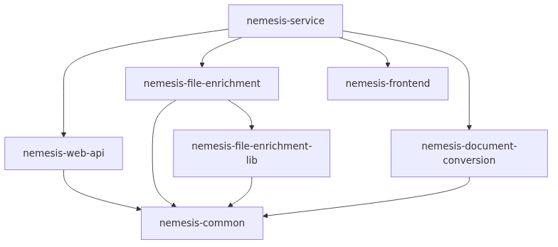
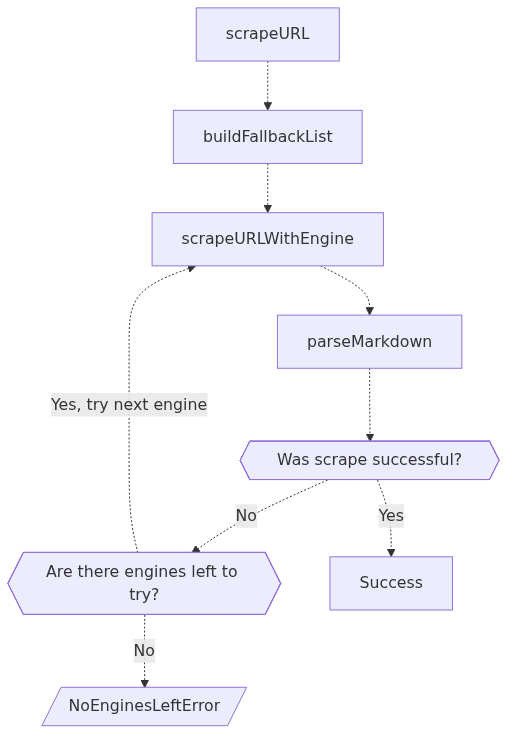
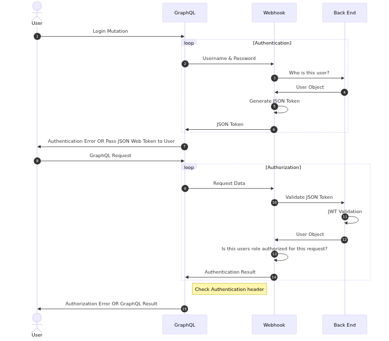
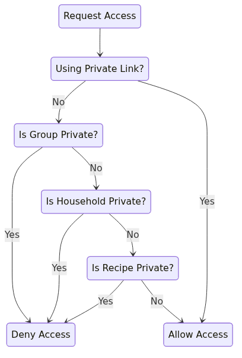

# 🎨 Architectural Diagrams

This directory contains Mermaid diagrams extracted from the Mental Prosthetic Platform codebase, revealing the architectural plans hidden throughout the repository.

## 📊 Available Diagrams

### 1. **Nemesis Service Architecture** (`nemesis-architecture.mmd`)
**Security Domain - Microservice Dependencies**

Shows the dependency graph for the Nemesis security analysis platform:
- Central `nemesis-service` coordinates all components  
- Web API, file enrichment, frontend, and document conversion services
- Shared `nemesis-common` library foundation
- Specialized `nemesis-file-enrichment-lib` for processing



### 2. **Firecrawl Processing Flow** (`firecrawl-flow.mmd`)  
**Productivity Domain - Data Processing Pipeline**

Demonstrates the scraping engine fallback strategy:
- URL scraping with multiple engine fallbacks
- Success/failure decision points  
- Error handling for exhausted engines
- Markdown parsing pipeline



### 3. **Ghostwriter Authentication** (`ghostwriter-auth.mmd`)
**Security Domain - Authentication Sequence**

Complete JWT authentication and authorization flow:
- User login mutation through GraphQL
- Webhook-based authentication loops
- Token generation and validation
- Role-based authorization checks



### 4. **Mealie Permissions** (`mealie-permissions.mmd`)
**Productivity Domain - Access Control State Machine**

Permission checking state diagram for recipe access:
- Private link bypass logic
- Group, household, and recipe privacy checks
- Allow/deny decision tree
- Hierarchical permission model



## 🛠️ Tools & Usage

### Generate All Diagrams
```bash
# Using the convenience script
./generate-diagrams.sh

# Using npm scripts  
npm run diagrams
```

### Generate Specific Diagram
```bash
# Single diagram
./generate-diagrams.sh nemesis-architecture.mmd

# Direct Mermaid CLI
npx mmdc -i nemesis-architecture.mmd -o nemesis-architecture.png
```

### List Available Diagrams
```bash
npm run diagrams:list
```

## 📁 File Structure

```
/workspaces/modular-monolith-2/
├── *.mmd                    # Mermaid source files
├── *.png                    # Generated PNG images  
├── *.svg                    # Generated SVG images
├── generate-diagrams.sh     # Convenience script
└── README-diagrams.md       # This file
```

## 🔍 Original Sources

These diagrams were extracted from:

- **Nemesis**: `apps/security/nemesis-service/NX_BEST_PRACTICES_README.md`
- **Firecrawl**: `apps/productivity/firecrawl-service/src/scraper/scrapeURL/README.md`  
- **Ghostwriter**: `apps/security/ghostwriter-service/DOCS/features/graphql-api/authentication.mdx`
- **Mealie**: `apps/productivity/mealie-service/docs/docs/documentation/getting-started/usage/permissions-and-public-access.md`

## 🎯 Architectural Insights

These diagrams reveal the Mental Prosthetic Platform's design patterns:

1. **Microservice Architecture** (Nemesis) - Clean dependency separation
2. **Pipeline Processing** (Firecrawl) - Fallback and error handling strategies  
3. **Security-First Design** (Ghostwriter) - Comprehensive auth/authz flows
4. **Hierarchical Permissions** (Mealie) - Granular access control

## 📝 Adding New Diagrams

1. Create a `.mmd` file with your Mermaid syntax
2. Run `./generate-diagrams.sh your-diagram.mmd` 
3. Add documentation to this README
4. Commit both source and generated files

## 🚀 Integration with Storybook

These architectural diagrams complement the executive function-optimized Storybook setup for comprehensive documentation of the 37-tool consolidation project.

---

*Generated on November 16, 2025 - Part of the Mental Prosthetic Platform documentation*
